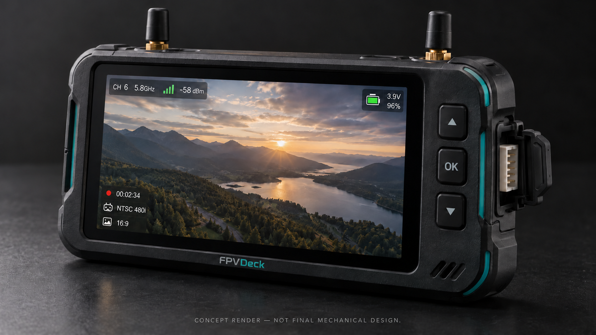

# FpvDeck

FpvDeck is an open handheld FPV field tool: a phone-sized 5-inch touchscreen,
dual 5.8 GHz analog receiver support, a low-latency FPV monitor, spectrum tools,
and a protected 2S–6S balance checker. It is a screen and field instrument—not
a radio transmitter.



> **CONCEPT RENDER — not mechanical CAD.** The enclosure and antenna placement
> remain subject to measured HAT, battery, connector, thermal, and RF clearances.

## Reference platform

- Waveshare ESP32-P4-WIFI6-Touch-LCD-5: ESP32-P4, ESP32-C6, 5-inch 720×1280
  MIPI-DSI IPS, GT911 capacitive touch, microSD, charger and 40-pin expansion.
- FpvDeck FPV HAT: one fitted and one optional RX5808 receiver, hardware RSSI
  diversity, TVP5150AM1 video decoder, three ADS1115 ADCs, protected balance
  input, three buttons, buzzer and buffered analog AV output.
- Flat protected 1S LiPo, 3000–4000 mAh, connected only through the Waveshare
  board's documented battery connector.

The previous RadioMaster T8L/Linux-radio-computer direction was retired on
2026-10-26. It remains available in Git history through commit `fd47ebd`; no
T8L, ELRS or RC-transmitter function is part of the current product.

## Applications

| App | Purpose | State |
| --- | --- | --- |
| Battery | 2S–6S cells, total, delta, limits and storage hint | UI scaffold + host-tested math; live polling pending HIL |
| Monitor | Low-latency analog video, channel, dual RSSI and active receiver | driver/UI scaffold; HIL required |
| Scanner | Band sweep, graph and strongest three channels | host-tested peak logic |
| Finder | Peak-hold RSSI with proportional buzzer cadence | host-tested state logic |
| Stream | Local WPA2 SoftAP MJPEG spectator view | interface scaffold; encoder/network integration pending |
| Settings | Brightness, video standard, buzzer, calibration and Wi-Fi password | NVS implementation |

## Build firmware

ESP-IDF **v6.1** is the pinned development release. Activate its environment,
then run:

```sh
idf.py set-target esp32p4
idf.py build
idf.py -p /dev/ttyACM0 flash monitor
```

The project defaults target ESP32-P4 rev3.x. Confirm the physical chip revision
before changing that profile.

## Run host tests

Pure logic has no ESP-IDF dependency:

```sh
./scripts/test-host
```

This covers RX5808 channel/register math, battery tap subtraction and detection,
RSSI smoothing/peak hold, and scanner peak selection.

## Generate the HAT design

```sh
python3 hardware/gen_hat.py
```

The generator validates references, net connectivity, labels and balanced KiCad
syntax, then writes the KiCad 8 schematic, BOM and audit netlist. The PCB is an
engineering placement/routing draft and is explicitly **not released for
fabrication** until the gates in [hardware/READINESS.md](hardware/READINESS.md)
are closed.

## Bring-up order

1. Inspect the unpowered HAT; verify no rail shorts.
2. Power only the Waveshare board and confirm 5 V/3.3 V header rails.
3. Fit the HAT without RX modules; scan I²C and confirm expected addresses.
4. Verify TVP5150 ID `0x51/0x50`, clock and reset timing.
5. Fit RX A with a dummy load/antenna and validate tuning plus RSSI.
6. Validate raw DVP capture before enabling PPA rotation/scaling and UI overlay.
7. Fit and validate RX B/diversity; then validate AV output.
8. Test balance inputs from a precision source before connecting a real LiPo.

See [the complete bring-up procedure](docs/BRINGUP.md).

## Documentation

- [Architecture](docs/ARCHITECTURE.md)
- [Hardware design](docs/HARDWARE.md)
- [Firmware design](docs/FIRMWARE.md)
- [Video and latency](docs/VIDEO.md)
- [Battery measurement](docs/BATTERY.md)
- [UI design](docs/UI.md)
- [Bring-up](docs/BRINGUP.md)
- [Decisions and open questions](DECISIONS.md)
- [Roadmap](TODO.md)

## Project status

- ✅ architecture reset and verified expansion-header mapping
- ✅ host-testable core logic and test runner
- ✅ ESP-IDF 6.1 firmware compiles for ESP32-P4 without warnings in project code
- 🚧 live sensor/video-to-display integration requires the physical stack
- 📐 generated KiCad schematic and PCB draft
- ⚠️ RX5808 module footprint/pinout requires physical verification
- ⚠️ no fabrication release or real-battery approval yet

## License

MIT. See [LICENSE](LICENSE).
