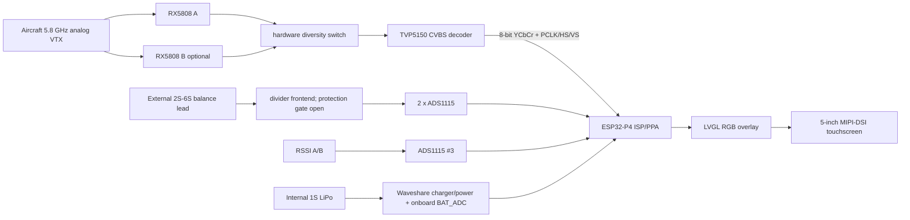

# Architecture

## Product boundary

FpvDeck combines a Waveshare ESP32-P4 5-inch touch platform, a replaceable FPV
HAT, and a single internal 1S battery. The external 2S–6S balance lead is an
instrument input only.

The 40-pin header carries 5 V, 3.3 V, shared I²C, eleven DVP signals, RX5808
tuning, diversity state, reset, three buttons, and buzzer PWM. The exact mapping
exists only in [`board_pins.h`](../firmware/main/board_pins.h).

## Failure containment

- The hardware video switch keeps selecting a receiver without a firmware loop.
- A missing HAT logs a warning and still permits the launcher/display to boot.
- Streaming is lower priority than local display and is disabled until measured.
- External battery energy is never connected to a FpvDeck power rail.
- Internal-cell voltage comes from the host board's existing GPIO20 BAT_ADC;
  raw battery voltage is not exposed by the 40-pin header.
