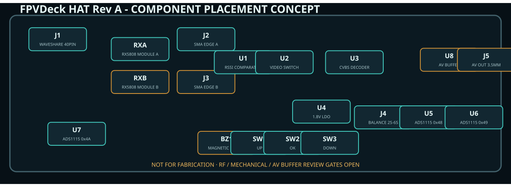

# Hardware design

## Stack

1. Waveshare ESP32-P4-WIFI6-Touch-LCD-5.
2. Rear 2×20 HAT, currently Rev A engineering draft.
3. Protected flat 1S LiPo, 3000–4000 mAh, after connector/polarity validation.
4. Future measured 3D-printed enclosure.

## HAT blocks

- RX A and RX B are both fitted in the final diversity assembly; RX B may remain
  DNP only for staged single-receiver bring-up. Each has separate filtered 5 V
  decoupling. The modules are side-by-side below two top-edge SMA connectors:
  RX A/top-left and RX B/top-right. Their provisional launches are approximately
  2.25 mm and 9.4 mm before stack-up tuning.
- LMV331 compares RSSI A/B. JP1 defaults its open-drain result into the
  SN74LVC1G3157 and reports the actual selection to the ESP32-P4. JP1 may instead
  hand selection to GPIO2 for a future quality-aware firmware policy.
- TVP5150AM1 accepts selected CVBS and emits 8-bit BT.601 YCbCr with discrete
  synchronization. Eleven 33 Ω source resistors isolate DVP edges.
- ME6211C18 makes 1.8 V; ferrites split analog and digital decoder rails. Its
  1 µF input/output capacitors and four TVP5150 100 nF local rail bypasses are
  explicit BOM items rather than layout notes.
- ADS1115 at 0x48/0x49 reads balance taps; the nominal internal-cell channel on
  0x49 is reserved/DNP because raw BAT is not exposed on the header. The host's
  existing GPIO20 BAT_ADC reads deck voltage. ADS1115 0x4A reads receiver RSSI.
  All three use TI's DGS pin order and a local 100 nF VDD bypass; this was
  independently rechecked after the initial generator was found to have the
  wrong ADC pin order.
- Three buttons are active-low to internal pull-ups. A transistor drives the
  buzzer so the GPIO does not source its current.
- AV out uses a high-impedance 100 nF AC-coupled branch into a TPF131-TR
  sync-clamp/video driver, followed by a 75-ohm source termination. Its pinout
  and local 100 nF + 4.7 uF bypass now match the manufacturer application data;
  amplitude and thermal margin still require a real 75-ohm load test.

## Board status

[`hardware/gen_hat.py`](../hardware/gen_hat.py) owns the checked parts/net
model. It emits the schematic, audit netlist, BOM, net-aware layout candidate,
and component view. A V1-spec provisional RX5808 footprint is now present for
physical overlay review, but is not fabrication-approved until the salvaged
modules are measured. See the [receiver/diversity research](../hardware/research/RX5808_FINAL_HAT.md)
and [release gates](../hardware/READINESS.md).

## Layout rules for the routed revision

- Four layers: signal/GND/power/signal; uninterrupted ground below RF and DVP.
- SMA-to-RX path grounded coplanar, 50 Ω, under 10 mm, with via fence.
- Keep both RX5808s and antennas away from DSI, DVP, ESP32-C6, and converters.
- Place TVP input termination at AIP1A and crystal network at pins 5/6.
- Fit no crystal load value until `CL1 = CL2 = 2CL - Cstray` is resolved for the
  chosen crystal/board; TI also requires the clock source within ±50 ppm.
- Match DVP data/sync paths within the budget derived from the actual stack-up.
- Put tap-side protection adjacent to J4; no tap trace enters digital areas first.
- Add readable probe labels and test points for every cumulative tap and rail.
