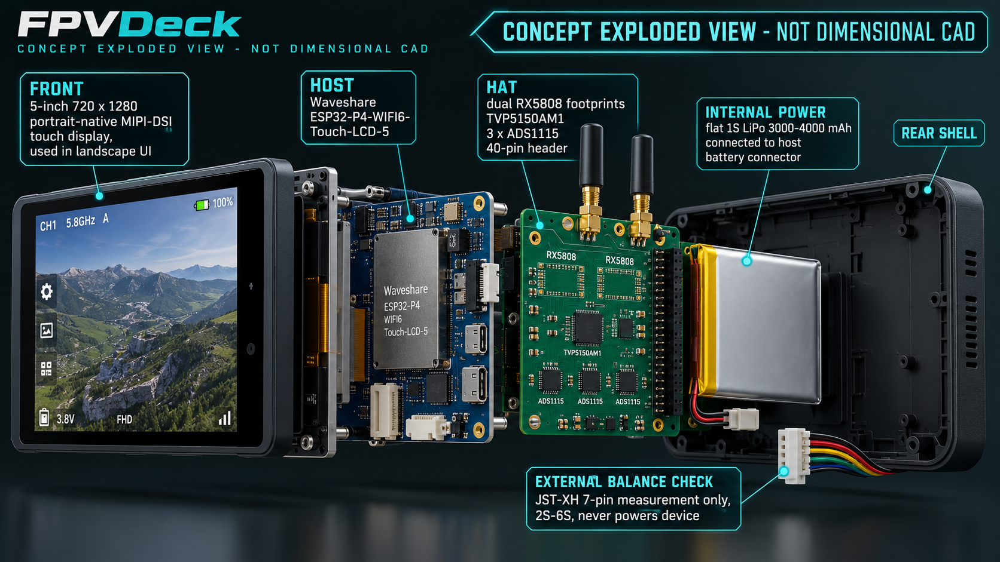

# User interface

The landscape UI is touch-first with three redundant buttons: up, OK, and down.
Minimum interactive target is 52 px; primary tiles are 250×112 px. Dark surfaces,
teal focus, text labels and shape changes avoid color-only status.

## Applications

- **Battery:** total, six large cell rows, delta, lowest/highest, warnings.
- **FPV monitor:** video-dominant screen with one compact telemetry strip.
- **Scanner:** tap-selectable RSSI bars and strongest three channels.
- **Finder:** glanceable session peak, explicit channel lock and optional
  non-blocking proportional buzzer.
- **Stream:** explicit status for local spectator SoftAP.
- **Settings:** live brightness, video mode, buzzer and masked WPA2 credential
  controls; calibration remains visibly disabled until HIL is safe.

Buttons are registered as an LVGL keypad. In the monitor, Up/Down directly tune
the previous/next channel and a deliberate OK long press opens the band picker;
the same actions have large touch targets. The scanner exposes its three strongest
measured frequencies as large buttons that tune and open the monitor. Streaming
or a settings failure must not block the monitor capture task. Physical usability
remains a HIL task. Production screens show explicit empty states rather than
plausible-looking fabricated readings whenever their hardware source is absent.
Battery and RSSI views already consume live snapshots; video/display handoff is
still the primary live-binding gate.

## Concept imagery

Both images are generated concepts, not dimensional CAD or routing evidence.
