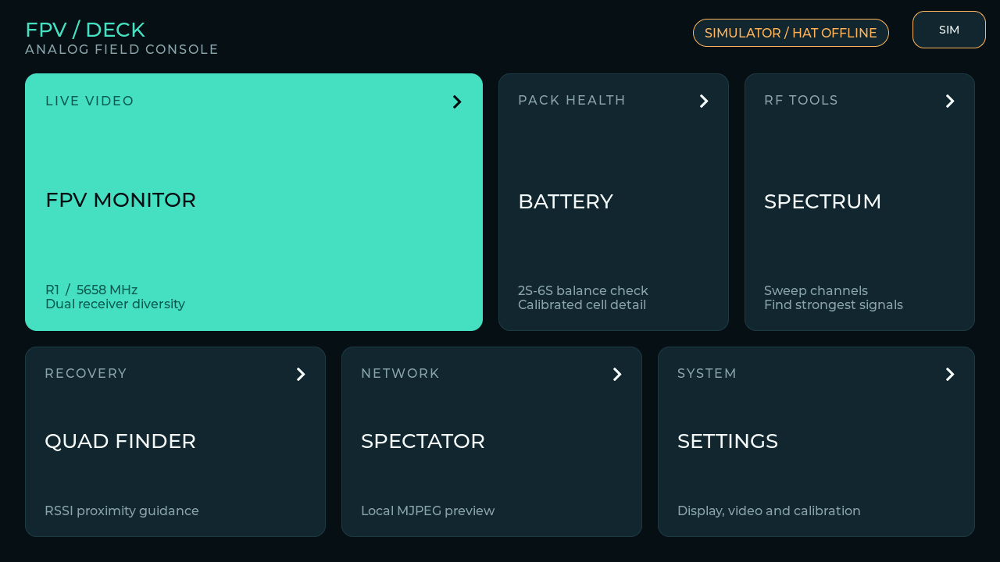
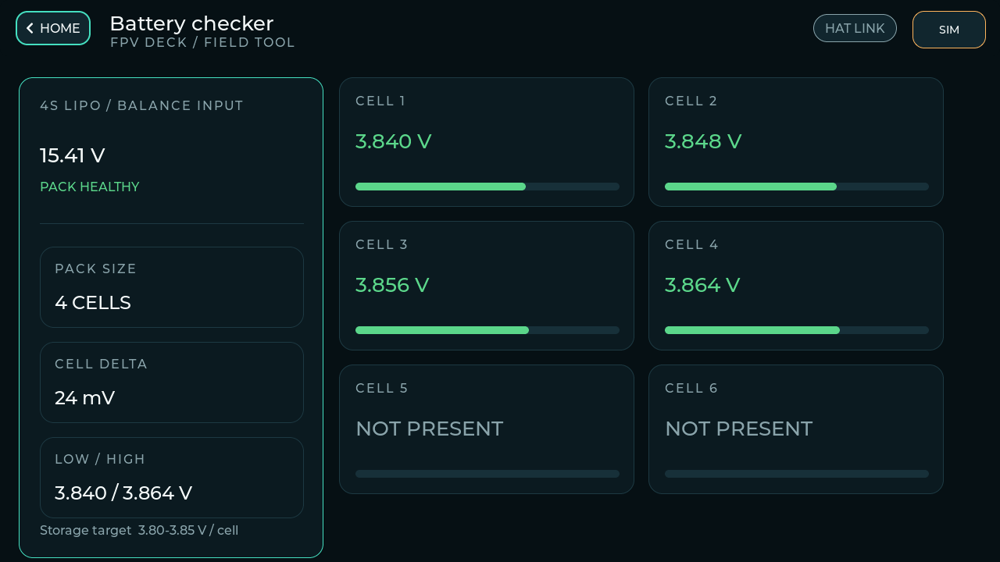

# User interface

The 1280×720 landscape UI is touch-first with three redundant buttons: up, OK,
and down. Its visual language is a compact field instrument rather than a grid
of generic embedded widgets: one high-priority action, asymmetric dashboard
cards, clear overlines, glanceable metric cards and a video-dominant monitor.

The source of truth is `firmware/main/ui_theme.c`. Its palette uses near-black
and blue-black surfaces, warm white text, muted blue-grey secondary text and one
mint interaction accent. Warning, danger and success always combine color with
text. Touch targets are at least 44 px and primary controls are 64 px or larger.
The same production components render in the desktop simulator.

## Applications

- **Battery:** dominant pack summary, compact health metrics and six persistent
  cell cards with voltage-range bars.
- **FPV monitor:** video-dominant screen with one opaque, compact telemetry rail.
- **Scanner:** tap-selectable RSSI bars and strongest three channels.
- **Finder:** glanceable proximity/peak metrics, explicit channel lock and
  optional non-blocking proportional buzzer.
- **Stream:** explicit status for local spectator SoftAP.
- **Settings:** live brightness, video mode, buzzer and masked WPA2 credential
  controls; calibration remains visibly disabled until HIL is safe.

Buttons are registered as an LVGL keypad. In the monitor, Up/Down directly tune
the previous/next channel and a deliberate OK long press opens the band picker;
the same actions have large touch targets. The scanner exposes its three
strongest measured frequencies as large buttons that tune and open the monitor.
Streaming or a settings failure must not block the monitor capture task.

Production screens show explicit empty states rather than plausible-looking
fabricated readings whenever their hardware source is absent. Battery and RSSI
views already consume live snapshots; video/display handoff is still the
primary live-binding gate.

## ESP32-P4 rendering budget

The design avoids effects that make embedded interfaces slow: there are no
gradients, blurred shadows, full-screen opacity layers or perpetual animations.
Screens build a static object tree and update existing labels/bars. Transitions
are 100 ms; Battery refreshes at 2 Hz, receiver metrics at 4 Hz and Finder UI at
10 Hz. Acquisition remains outside the LVGL task.

Firmware enables LVGL's ESP32-P4 PPA draw unit with 128-byte bursts. It can
offload eligible opaque, square fills; rounded cards and text correctly fall
back to the two software draw units. Object style caching is enabled, the LVGL
refresh period is 15 ms, and PSRAM/cache settings retain 128-byte alignment.
This is a code/configuration optimization, not a performance claim: frame time,
PSRAM bandwidth and touch-to-photon latency remain physical-HIL measurements.

## Concept imagery

Both images are generated concepts, not dimensional CAD or routing evidence.
