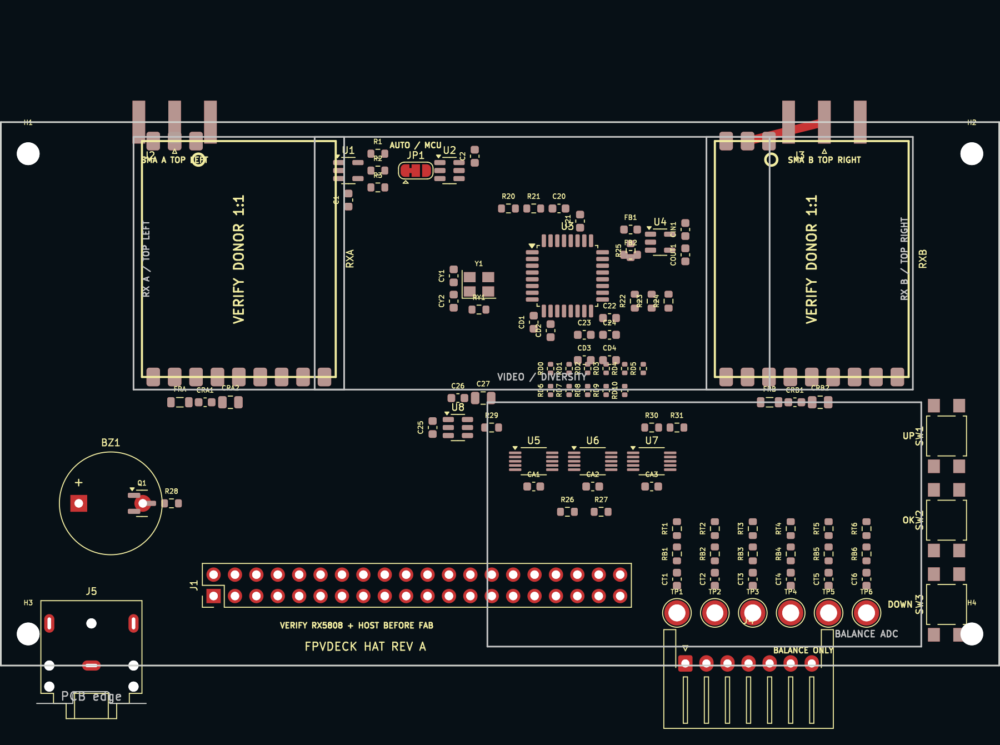

# FPV HAT Rev A — peer review guide

This is the focused review package for the dual-RX5808 HAT. It is an
engineering layout candidate, **not a fabrication release**. The two salvaged
receiver modules sit side-by-side below SMA A/top-left and SMA B/top-right.



## Signal path

```text
SMA A -> RX5808 A --CVBS A--\
                            SN74LVC1G3157 -> TVP5150 -> 8-bit DVP -> ESP32-P4
SMA B -> RX5808 B --CVBS B--/
                 \--RSSI A/B -> ADS1115 + LMV331 comparator
```

Both RX5808 modules are programmed to the same channel. Shared DATA/CLK and
separate LE lines allow both receivers to be tuned while preserving independent
module selection. The selected composite stream alone reaches the TVP5150.

## Two selectable diversity policies

JP1 chooses the owner of the video switch:

- **Hardware auto, JP1 pins 1–2 (default):** LMV331 compares the two RSSI
  voltages with hysteresis and directly controls the SN74LVC1G3157. It remains
  functional if application firmware is busy. This is classic RSSI diversity.
- **P4 quality-aware, JP1 pins 2–3:** ESP32-P4 GPIO2 controls the switch. Firmware
  can combine calibrated RSSI A/B, TVP5150 lock/standard status, minimum dwell
  time and field-boundary switching. `ACTIVE_RX` reports the actual selection.
  The policy is an intended firmware feature and still needs bench validation.

These modes are alternatives selected by JP1; they are not simultaneous image
fusion. ImmersionRC rapidFIRE's proprietary reconstruction combines information
from two received images. Rev A has one analog switch and one decoder, so it can
perform classic or software-directed diversity but cannot honestly claim that
fusion behavior. A true fusion revision would need two simultaneous decoder
paths, timing alignment, substantially more video bandwidth and a validated
fusion pipeline.

## Files to review

- [Top view](export/fpv-hat-top.png) and [bottom view](export/fpv-hat-bottom.png)
- [KiCad PCB](fpv-hat.kicad_pcb) and [schematic](fpv-hat.kicad_sch)
- [BOM](bom.csv) and [checked netlist](netlist.txt)
- [Receiver/diversity research](../research/RX5808_FINAL_HAT.md)
- [Readiness gates](../READINESS.md)

## Review checklist

1. Overlay each desoldered RX5808 at 1:1 and verify body, pad pitch, pin-one
   orientation, shield overhang and underside keep-outs. The footprint remains
   provisional until this is completed for both modules.
2. Verify RX5808 serial-programming mode and pin assignment by continuity on the
   donor board; do not apply 5 V logic to ESP32-P4 GPIO.
3. Check both top SMA positions against the physical module RF pad and enclosure
   wall. Confirm the upper-right host mounting point stays clear.
4. Recalculate grounded-coplanar width/gap from the chosen four-layer fab stack,
   then route both launches below 10 mm with continuous ground and via fencing.
5. Review LMV331 polarity, hysteresis, open-drain pull-up and JP1 default state;
   confirm high `ACTIVE_RX` means RX A in hardware and firmware.
6. Review the 75-ohm CVBS loading, switch common-mode range, TVP5150 input
   attenuation/coupling, AV buffer branch and transient behavior on switching.
7. Confirm every ESP32-P4 DVP/header assignment against the Waveshare schematic
   and validate PCLK capture margin on hardware.
8. Review JST-XH tap protection, ADS1115 divider worst cases, partial insertion,
   creepage and the rule that the external pack never powers the Deck.
9. Verify 5 V current headroom with two receivers, decoder, ADCs, host display
   and Wi-Fi active; complete thermal and brownout tests.
10. Complete all routing, planes, ERC/DRC, manufacturing clearances and the
    readiness checklist before generating fabrication outputs.
